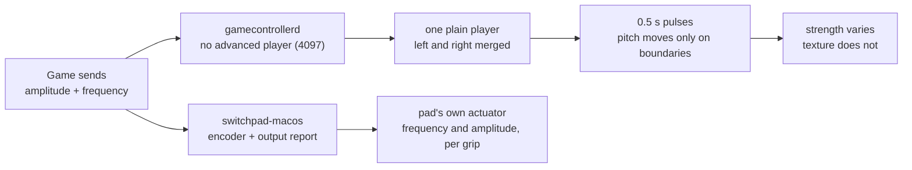

# switchpad-macos

**Your Switch controller pairs with a Mac and rumbles. It just doesn't rumble the way it does on a Switch.**
This repository explains why, ships a dependency-free encoder that fixes it, and gives you a ten-second
experiment you can hear, not just read about.

On macOS 26, `GameController` reports *no advanced player* for a Pro Controller, falls back to one plain player whose
left and right engines overwrite each other, and plays 0.5-second pulses — so strength changes but **texture and pitch
do not**. A first-generation Joy-Con is worse: its `haptics` property is `nil`, so some engines never even ask the game
for a vibration value. The pad's own HID output report has none of these limits. Writing it directly is what this does.

| | status | how it was checked |
|---|---|---|
| **Pro Controller** — play, sweep, curve, tune | ✅ working | hardware, Bluetooth: `IOHIDDeviceOpen` → `OK`, `0x48 0x01` → `OK`, reports `0x01` → `OK` |
| **Frequency mapping** — 81.75–1252 Hz | ✅ working | a sweep changes texture with pitch; a melody is recognisable when the pad rests on a table |
| **Joy-Con (1st gen)** — HD rumble in a game | ✅ working, elsewhere | hardware, in [nxnative PR #2183](https://github.com/seedds/nxnative/pull/2183); the encoder here is byte-identical |
| **Encoder** — `swrumble.c`, zero dependencies | ✅ working | `make test` walks every published frequency row and all 101 amplitude steps; zero warnings |
| **Continuous in-game Pro Controller rumble** | ⚠️ **not provided** | an engine integration failed on hardware; [the failure report](docs/pro-controller.md) is required reading before attempting one |
| Input, pairing, motion, player lights | — | `GameController`'s job, not this one |

Everything above was measured on **macOS 26.6.2 over Bluetooth**, with a 1st-generation Pro Controller and a pair of
1st-generation Joy-Con. Other macOS versions, USB, and Switch 2 controllers were **not tested**.

## Ten seconds to hear it

```sh
make
./build/swr-haptic sweep
```

```
$ ./build/swr-haptic sweep
sweeping the high band; the texture should sharpen as it climbs
  90 Hz
  120 Hz
  160 Hz
  ...                     (output abridged)
  1252 Hz
```

Rest the pad on a table: the table is the sounding board, and the pitch climbs. That is the check that the frequency
codes — not only the amplitudes — are reaching the actuator.

```sh
./build/swr-haptic tune        # Beethoven's Ode to Joy, 28 notes, played through the actuator
./build/swr-haptic tune "C5:200 E5:200 G5:400 C6:600"    # or any melody you like
```

```
$ ./build/swr-haptic tune
Pro Controller: Ode to Joy, the first two phrases
  E4    329.6 Hz  250 ms
  F4    349.2 Hz  250 ms
  G4    392.0 Hz  250 ms
  ...                     (output abridged)
28 notes
```

An actuator has one degree of freedom; its frequency is its pitch. A melody is therefore a list of standard pitches,
and playing one recognisably is a stronger test of the frequency table than any unit test.

## Quick start

```sh
make && make test
./build/swr-haptic list
./build/swr-haptic play --amp 0.9 --freq 320 --ms 400
./build/swr-haptic curve       # the same quiet hit, flat then shaped
```

```
$ ./build/swr-haptic play --amp 0.9 --freq 320 --ms 400
Pro Controller: amp 0.90, 320 Hz, 400 ms, gain 1.00, gamma 1.00
```

Requires a Mac with a Nintendo pad already paired over Bluetooth. No driver, no kernel extension, no entitlements,
no package manager.

## The problem, in three steps



The amplitudes make it worse. A game tuned for the console's actuator sends very little: *Ocarina of Time* peaks at
**0.06**, and a linear 3× gain leaves it at 0.18 — a whisper. Upstream
[nxnative#2148](https://github.com/seedds/nxnative/issues/2148) measured exactly this and proposed a local patch;
it is still an open issue, with no merged fix.

## What this does instead

The observation this rests on: **`GameController` holds a pad's input path but does not own the device.** An
`IOHIDDeviceOpen(dev, kIOHIDOptionsTypeNone)` succeeds while `gamecontrollerd` is reading it, so a second holder can
write output reports without seizing input, without a driver, and without touching the pad's connection.

Measured on a Pro Controller over Bluetooth:

```
IOHIDDeviceOpen(kIOHIDOptionsTypeNone)  -> 0x00000000  OK
IOHIDDeviceSetReport(0x01, 49 bytes)    -> 0x00000000  OK
subcommand 0x48 0x01 (EnableVibration)  -> 0x00000000  OK
```

Without `0x48 0x01` the firmware stays mute. With it, the pad plays.

A word on report IDs, because it matters: **`0x01` is "rumble and subcommand", `0x10` is "rumble only"**. This
repository's CLI uses `0x01` for short, bounded bursts (it needs `0x01` to carry `0x48`). A continuous stream should
use `0x10` with a 30 ms cadence. That distinction is the subject of
[the failure report](docs/pro-controller.md) — please read it before wiring this into an engine.

## Using the encoder

`swrumble.c` has no dependencies and no platform code — it turns a vibration value into four bytes, and nothing else.

```c
#include "swrumble.h"

swr_value v = { .amplitude_low = 0.25f, .amplitude_high = 0.9f,
                .frequency_low = 150.0f, .frequency_high = 320.0f };
uint8_t actuator[4];
swr_encode(actuator, &v, 1.0f, 1.0f, 1.0f);   /* gain, curve, frequency blend */
```

Then put those four bytes where the report wants them. For a one-off frame on a Pro Controller:

```c
uint8_t report[49];
size_t n = swr_report_pro(report, sizeof report, counter++, left, right, 0, NULL, 0);
IOHIDDeviceSetReport(dev, kIOHIDReportTypeOutput, 0x01, report, (CFIndex)n);
```

`counter` must advance on every report or the pad drops it as a duplicate. For a sustained stream, see the
[cadence and silence requirements](docs/pro-controller.md) first — a single write is not a reliable stop.

## The strength curve

`swr_shape(amplitude, gain, gamma)` is `amp^gamma * gain`, clamped. A gamma below 1 lifts the quiet end without
touching the loud end, which is what a game with a 0.06 peak needs and what a flat gain cannot do without clipping
everything above 0.33:

| input | `gain 3, gamma 1` | `gain 3, gamma 0.5` |
|---|---|---|
| 0.06 | 0.18 (a whisper) | **0.73** |
| 0.33 | 1.00 (clipped) | 0.83 |
| 1.00 | 1.00 | 1.00 |

This is the useful half of [nxnative#2148](https://github.com/seedds/nxnative/issues/2148)'s patch. The other half, a
250 ms hold, compensates a rotor motor's spin-up; these are linear resonant actuators that stop in about ten
milliseconds, so holding a pulse smears it instead of strengthening it.

## The protocol, in one page

| | |
|---|---|
| frequency code | `code = round(32 * log2(f / 40))`, so 160 Hz is `0x40` and 320 Hz is `0x60` |
| low band | codes `0x01`–`0x7F`, 41–626 Hz |
| high band | codes `0x21`–`0x9F`, 81.75–1252 Hz; its report field is `(code - 0x20) * 4`, from `0x04` to `0x1FC` |
| amplitude | 101 steps; the high band's code is `2 * step`, the low band's is `0x40 + step / 2` |
| neutral | `00 01 40 40` — not `00 00`, which the firmware reads as the start of a subcommand |
| Pro Controller | `0x01` rumble + subcommand (49 B over Bluetooth), `0x10` rumble only (8 B body) |
| Joy-Con | `0x30`, same eight rumble bytes |

dekuNukem's notes write the frequency row as `round(32 * log2(f / 10))`. The two forms are **bit-identical**:
`log2(f/40)*32 = log2(f/10)*32 - 64`, and `0x40` is exactly the offset subtracted from the code. `make test` walks the
published frequency rows and all 101 amplitude steps to keep it that way.

The amplitude table is [SDL](https://github.com/libsdl-org/SDL)'s (`SDL_hidapi_switch.c`); the frequency rows are
[dekuNukem's](https://github.com/dekuNukem/Nintendo_Switch_Reverse_Engineering) reverse-engineering notes. Neither is
required to build this.

## Where this sits

Two layers sit above this library, and only one of them takes patches:

| layer | what it is | gets fixed by |
|---|---|---|
| [seedds/nxnative](https://github.com/seedds/nxnative) | **the engine.** Rebuilds the game's graphics on Metal and talks to the pads | a pull request — [PR #2183](https://github.com/seedds/nxnative/pull/2183) is the Joy-Con half of this work |
| NX2Apple | **a community front end** listed in nxnative's "Community front ends" section (`org.nxnative.NSPortBuilder`): a GUI that packs a game into a double-clickable `.app` and ships its own pinned engine | upgrading its engine, which only happens after a patch lands upstream |
| this repository | the encoder and the tooling, usable by either, dependent on neither | — |

That ordering is why the PR matters more than a local branch: a fork of the engine reaches one Mac, a merged patch
reaches every copy of it, including the one NX2Apple downloads.

## Further reading

- [Why a Pro Controller kept rumbling](docs/pro-controller.md) — a measured failure: four semantics that a HID rumble
  writer has to provide, a watchdog that trusted an unacknowledged write, and the parts we could not prove.
- [dekuNukem/Nintendo_Switch_Reverse_Engineering](https://github.com/dekuNukem/Nintendo_Switch_Reverse_Engineering) — the reports, the tables, the subcommands.
- [libsdl-org/SDL](https://github.com/libsdl-org/SDL) — the amplitude table and the packing this encoder follows.

## License

MIT. The tables are facts measured from the hardware; the code is new.
